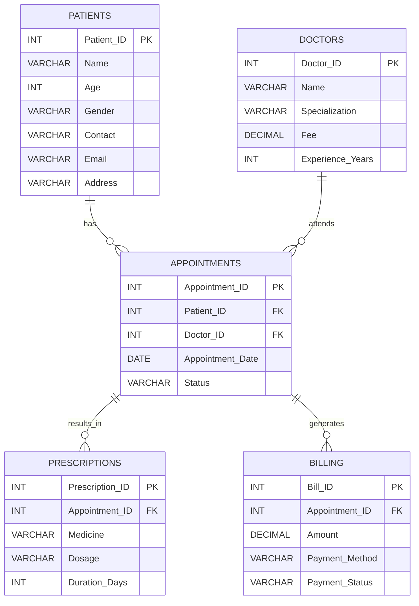

# MediTrack

MediTrack is a hospital management database project built with **MySQL**. It stores and connects patient records, doctor details, appointments, prescriptions, and billing records using relational tables, primary keys, and foreign keys.

## Entity Relationship Diagram



## Entities and Attributes

| Entity | Attributes |
|---|---|
| **Patients** | `Patient_ID` (PK), `Name`, `Age`, `Gender`, `Contact`, `Email`, `Address` |
| **Doctors** | `Doctor_ID` (PK), `Name`, `Specialization`, `Fee`, `Experience_Years` |
| **Appointments** | `Appointment_ID` (PK), `Patient_ID` (FK), `Doctor_ID` (FK), `Appointment_Date`, `Status` |
| **Prescriptions** | `Prescription_ID` (PK), `Appointment_ID` (FK), `Medicine`, `Dosage`, `Duration_Days` |
| **Billing** | `Bill_ID` (PK), `Appointment_ID` (FK), `Amount`, `Payment_Method`, `Payment_Status` |

## Key Relationships

| Relationship | Cardinality | Description |
|---|---:|---|
| Patients — Appointments | 1:M | A patient can have multiple appointments. Each appointment references one patient. |
| Doctors — Appointments | 1:M | A doctor can have multiple appointments. Each appointment references one doctor. |
| Appointments — Prescriptions | 1:M | An appointment can have multiple prescriptions. Each prescription references one appointment. |
| Appointments — Billing | 1:M | An appointment can have multiple billing records. Each billing record references one appointment. |

## Database Tables

- `Patients`
- `Doctors`
- `Appointments`
- `Prescriptions`
- `Billing`

## Setup

1. Open MySQL Shell in SQL mode and connect to your MySQL server.
2. Create or select the database:

   ```sql
   CREATE DATABASE MediTrack;
   USE MediTrack;
   ```

3. Run the `CREATE TABLE` statements in this order so referenced tables exist first: `Patients`, `Doctors`, `Appointments`, `Prescriptions`, `Billing`.
4. Run the corresponding `INSERT` statements to add records.

## Verify the Data

```sql
USE MediTrack;

SHOW TABLES;
SELECT * FROM Patients;
SELECT * FROM Doctors;
SELECT * FROM Appointments;
SELECT * FROM Prescriptions;
SELECT * FROM Billing;
```

## Notes

- `PK` means primary key; `FK` means foreign key.
- The schema uses explicit integer primary keys rather than `AUTO_INCREMENT`.
- Foreign keys connect appointments to patients and doctors, and connect prescriptions and billing records to appointments.

